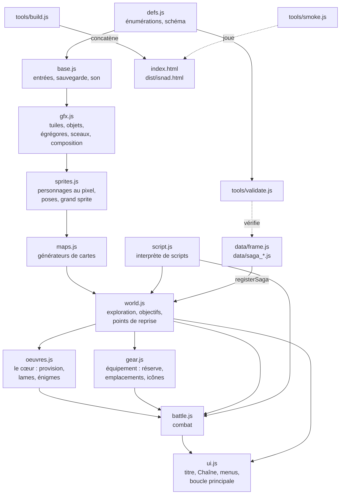

# Architecture — étape 2

## Choix

**Un seul fichier HTML, exécuté entièrement dans le navigateur.** Pas de serveur, pas de compte, pas
de bibliothèque, pas d'image ni de fichier son. Ce choix est imposé par la porte de publication :
un Artifact n'admet ni média externe ni requête réseau, et il est justifié par le profil (D2 = 1,
D5 = 1). Seule ressource distante : quatre polices Google Fonts, chacune avec une pile de repli.

| Question | Réponse |
|---|---|
| Local ou distant | Local. Tout tourne dans la page. |
| Données | `localStorage`, clé `isnad.save.v1`. Rien ne quitte le navigateur. |
| Dépendances d'exécution | Aucune |
| Dépendances de développement | Node (build, validateur), Playwright et Chromium (tests) |
| Coût des services | Zéro |
| Fournisseur non remplaçable | Aucun. `index.html` se sert depuis n'importe quel hébergement statique. |

## Modules

Chaque module est une fonction immédiate qui s'attache à `window.ISNAD`. L'ordre de chargement est
fixé dans `tools/build.js` : `defs`, `base`, `gfx`, `sprites`, `maps`, `script`, `world`, `build`,
`trade`, `oeuvres`, `gear`, `battle`, `ui`, puis `frame.js`, `music.js`, `caid.js`, `coeur.js`, puis les sagas
par ordre alphabétique, puis le démarrage (`ISNAD.ui.boot()`).

**Fenêtre visible.** Le canevas garde toujours 384 × 216 pixels logiques. Sur un écran en hauteur,
la scène n'en montre qu'une fenêtre (`G.view`), que la feuille de style agrandit et que le monde fait
suivre au héros ; les combats rapprochent les deux camps du centre. Rien d'autre ne change dans le
rendu, et les plaques posées sur l'image se placent par rapport à cette fenêtre.

**Chemin au doigt.** `W.route` parcourt la grille en largeur jusqu'à la case praticable la plus proche
du point touché ; `W.goTo` fait suivre ce chemin en coupant les angles quand la ligne droite est libre.
`W.tap` décide de ce que le toucher veut dire : aller là, parler, ouvrir, s'adresser à une chose.

**Équipement.** `gear.js` ne connaît que trois choses : ce que chacun porte (`equip`, par héros), la
réserve commune (`gear`) et le catalogue de `defs.js`. Les statistiques d'un héros se demandent toujours
à `I.calc.of(h)`, qui applique les pourcentages des pièces portées à `I.calc.hero(def, niveau)` ; le
combat lit en plus `gear.traits(h)` (percer, parer, tenir bon…) et dessine `gear.look(h)`, la silhouette
du héros telle qu'il est équipé. Hors combat, la silhouette reste celle du fichier de saga.

**Version 7.** `mal.js` (l'organigramme du mal) se charge après `gear.js` : enracinement d'une idole,
réponse parlée à une idée noire, page de la halte. Il lit les récits par `D.parcours` (`defs.js`), le même
parcours que le validateur. Outils ajoutés : `tools/son.js` (la musique écoutée pendant que le jeu se joue)
et `tools/mesure-musique.js` (niveau de chaque piste).

`rangs.js` (la bataille déclarée) se charge après `mal.js` et avant `battle.js`. Il ne touche pas au combat : le
combat lui prête ses menus, ses bandeaux et trois effets (`champApi` : ôter un voile à l'idole, révéler une faille,
semer le doute) et l'appelle à quatre endroits : la mise en place, le pas (après un tour de l'idole), l'entrée
« Ordonner » du menu, le dessin. Le champ se dessine là où le panneau du combat ne le couvre pas (toute la scène en
hauteur, le haut de la scène en largeur). Outil : `tools/bataille.js`.

**Version 8.** `valeurs.js` (le côté du bien) se charge après `mal.js`. Il ne garde rien : une Valeur se lit dans
`vices`, un attribut dans `lames`. Il ouvre aussi les portes de la noosphère, et prête au combat un groupe d'un seul :
le râwî (`heros`, `sansReprise`, `interieur`). La page de préparation est une page de la halte (`U.prepare`), appelée
par `battle.js` avant chaque tentative contre une idole. `tools/promo.js pdf` imprime le livret en PDF.

## Rendu rétro-HD

Le monde est dessiné sur une **couche pixel de 384 × 216**, puis composé sur le canevas d'affichage,
dont la taille est un multiple entier (× 2 à × 5) de cette couche. `gfx.present()` enchaîne :

1. agrandissement de la couche pixel sans lissage ;
2. copie floue au quart de la résolution, réutilisée par les étapes 3 et 5 ;
3. profondeur de champ : bandes floues en haut et en bas ;
4. éclairage : une carte de lumière à demi-résolution, remplie de la teinte ambiante, où chaque source
   s'ajoute, puis **multipliée** sur l'image ;
5. halo : la copie floue en mode écran ;
6. lueurs additives des sources, rayons de lumière ;
7. particules dessinées en pleine résolution (poussière, sable, braises, pluie, glyphes, effets de combat) ;
8. étalonnage par heure du jour, teinte de scène ;
9. lignes de balayage et décalages pour les lieux cyber ;
10. vignette, éclair, tremblement.

L'interface (dialogues, menus, plaques de combat, nombres de dégâts) est en HTML et CSS au-dessus du
canevas : le texte reste net à toute taille. Une variable `--u` vaut un pixel logique et règle les
tailles.

## Génération procédurale

| Élément | Méthode |
|---|---|
| Tuiles 16 × 16 | Une fonction par type, bruit semé par un hachage du nom ; quatre variantes par tuile |
| Objets | Environ quarante dessins vectoriels en basse résolution, avec empreinte de collision |
| Personnages | Planche 4 directions × 3 poses à partir de couleurs et d'un type ; aucun trait de visage |
| Égrégores | Quinze formes abstraites tracées en vectoriel, puis passe « pixel art » : alpha net, contour, liseré, ombrage tramé |
| Sceaux | Médaillon géométrique avec le nom en arabe, dessiné sur canevas |
| Cartes | Boîte à outils (`MB`) : remplissage, maisons, routes, dispersion, lieux nommés ; dix générateurs ; sol précalculé |
| Décors de combat | Dégradé, silhouettes selon le lieu, grille en perspective animée |
| Son | Web Audio : bande-son synthétisée (séquenceur multi-voix), percussions, bruitages brefs ; aucune nappe de fond |

Tout est déterministe : la même carte donne le même dessin.

## Interprète de scripts

Un chapitre est une suite d'objectifs ; chaque objectif porte un script, tableau d'opérations
(`say`, `nar`, `quote`, `choice`, `battle`, `map`…). `script.run()` les exécute une à une en
asynchrone. Tant qu'un script court, le déplacement est verrouillé. Les entrées passent par une pile
de gestionnaires : le plus récent (un menu, un dialogue) reçoit l'action.

## Sauvegarde et points de reprise

À chaque objectif atteint, `world.checkpoint()` enregistre : saga, chapitre, indice d'objectif, carte
et options, position, groupe, état des PNJ (cachés, position), ennemis vaincus, coffres ouverts,
drapeaux. S'y ajoutent les niveaux des héros, la besace, la réserve d'équipement et ce que chacun porte, le
codex, les Lumières et le compte de fidélité. Toute lecture ou écriture est protégée : sans stockage, le jeu fonctionne, sans reprise.
Un objectif interrompu en cours de script est rejoué depuis son début.

**Sauvegarde automatique.** Chaque point de reprise écrit toute la partie dans `isnad.auto.v1` (même
format que les trois emplacements). En promenade libre, un point de reprise est pris toutes les douze
secondes, jamais pendant un récit : l'état écrit est toujours celui d'un moment de repos, et un objectif
interrompu se rejoue en entier sans rien compter deux fois. L'écran de la Chaîne écrit aussi la partie
(point de reprise vide : « Continuer » rouvre la Chaîne). Les trois emplacements (`isnad.slot.N`) ne
servent plus qu'à garder des copies. Règle à tenir : **on n'écrit jamais la partie au milieu d'un objectif**.
Une prière jouée par le récit (opération `pray`) repose le groupe sans prendre de point de reprise ; le
bouton de secours relit la partie écrite avant de repartir.

## Flux du produit et chemin dans le schéma

| Flux | Chemin |
|---|---|
| Démarrer, continuer | `ui` → `save` → `world.startChapter` |
| Explorer, parler | `world.update` / `world.interact` → `script.run` |
| Combattre | `script` ou `world.fight` → `battle.start` → retour à la scène précédente |
| Choisir une saga | `ui.showChain` → `ui.startSaga` |
| Consulter le codex | `ui.pause` |

## Outils

- `tools/validate.js` charge une saga dans un contexte isolé et vérifie chaque référence.
- `tools/build.js` concatène et écrit la page autonome et le fragment pour Artifact.
- `tools/smoke.js` ouvre le jeu dans Chromium, prend des captures, puis joue la partie entière en mode
  automatique : dialogues et choix avancent seuls, les combats sont menés par une IA de test, et
  l'accessibilité à pied de chaque objectif est vérifiée par un parcours en largeur sur la grille.
  Il ouvre aussi les coffres du lieu, et relève tout texte affiché sous le noir d'un fondu (« TEXTE CACHÉ »).
- `tools/doigt.js` joue le prologue comme un joueur, au doigt et sans aucun raccourci, sur trois tailles
  d'écran. Avant chaque toucher il regarde l'écran : ce que le jeu attend est-il dans l'image, ni vide, ni
  transparent, ni sous un fondu ? Il compte aussi les menus de choix : un menu qui se referme sans avoir été
  touché trahit un toucher fantôme. Avec `loin`, il poursuit jusqu'à la fin du premier chapitre de la
  saga I (le premier combat au doigt, les suivants par l'IA de test). `smoke.js` prouve que le récit se
  déroule ; `doigt.js`, qu'il se voit.

## Ajouts de la version 2

- **Séquenceur musical** (`src/core/base.js`) : chaque piste est une liste de voix (timbre, volume, notes
  en texte) ; le séquenceur planifie les notes en avance sur l'horloge audio. Timbres synthétisés :
  `pulse, square, triangle, saw, sine, pluck, flute, strings, bell, drums`. Bus de musique séparé, écho
  léger, limiteur en sortie. Les pistes sont dans `src/data/music.js`.
- **Pourparler, prière, piliers** : opérations `parley`, `pray`, `pillar`, `mus` de l'interprète
  (`src/core/script.js`) ; état des piliers dans la sauvegarde (par saga, et global pour la Citadelle).
- **Carte `citadelle`** et lieux `priere`, `ecole`, `quartier` ajoutés aux générateurs (`src/core/maps.js`).
- **Bascule de rendu** : `G.low` coupe le flou, les nuages, le balayage et abaisse la résolution, à la
  main (options) ou quand les images s'allongent.

## Limites connues

- Pas de manette physique, pas de reprise au milieu d'un script.
- La composition redessine tout l'écran à chaque image ; non mesuré sur appareil modeste.
- Le canevas n'est pas décrit aux technologies d'assistance.
